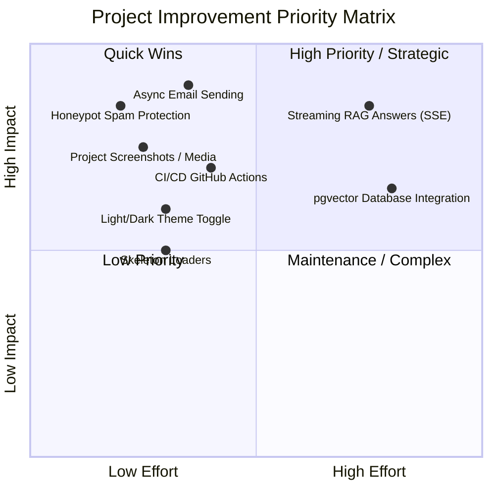

# Portfolio-Expo: Project Audit, Completed Features & Improvement Roadmap

**Project:** Portfolio Expo (Full-Stack Expo + Django Application)  
**Author:** Siva Kumar Annam (Mr.A.S.K)  
**Date:** October 2026  
**Status:** All Core Ends Tested & Functional  

---

## 1. Executive Summary

This document provides a complete audit of the **Portfolio-Expo** project. It details everything that has been tested and verified across both the frontend (Expo / React Native Web) and backend (Django REST Framework + PostgreSQL / SQLite), documents the issues identified and resolved, and outlines an actionable improvement roadmap across architecture, user experience, security, and deployment.

---

## 2. What Has Been Done Successfully

### 2.1 Frontend (Expo & React Native Web)
- **Multi-Platform Support**: Built with Expo SDK 57, React Native 0.86, and React Native Web 0.21, running seamlessly on web (`http://localhost:8081`), iOS, and Android.
- **Expo Router Architecture**: File-based routing with route groups (`app/(tabs)`) and dynamic routes (`app/project/[slug].tsx`).
- **Interactive Navigation**:
  - Desktop sidebar with photo, branding (`Mr.A.S.K`), quick contact buttons (Email, GitHub, LinkedIn), and dynamic active tab indicator.
  - Mobile responsive top header bar with horizontal scrollable tab navigation.
- **Typography & Theme System**: Curated dark palette (`#050A0F`, `#0B0F13`, `#7DB9FF`) with glassmorphism cards and smooth typewriter animations on the home screen.
- **Static Route Export**: Successful static production export (`expo export --platform web`) generating all 16 static routes into `dist/`.
- **Zero TypeScript Errors**: `npx tsc --noEmit` verified with zero type errors.

### 2.2 Backend (Django REST Framework)
- **Django 6.1 WSGI/ASGI Setup**: Modular Django architecture located in `backend/` with REST framework endpoints.
- **Database Migrations & Models**:
  - `Project`: stores project title, role, summary, stack, highlights, pipeline steps, GitHub link, demo URL, and demo kind.
  - `ContactMessage`: persists incoming contact form submissions with timestamps and status.
  - Both SQLite (local dev) and PostgreSQL (production via `POSTGRES_DB` env) supported.
- **Live Weather API Integration (`/api/weather/`)**:
  - Geocoding lookup via Open-Meteo geocoding service.
  - Live 5-day temperature forecast with WMO weather codes and weather emoji icons.
- **RAG Chatbot Endpoint (`/api/rag/ask/`)**:
  - Accepts multipart PDF and text uploads.
  - Extracts text with `pypdf`, chunks documents, and creates embeddings via `sentence-transformers`.
  - Interfaces with a local **Ollama** LLM (e.g. Qwen2.5) for grounded document Q&A, with fallback excerpts.
- **Automated Backend Test Suite**:
  - Full Django test suite in `backend/portfolio/tests.py` covering all 8 critical endpoints and validations (all 8 tests passing).

### 2.3 Contact Form & Email Pipeline
- **Real SMTP Email Dispatch**:
  - Contact submissions automatically trigger Gmail SMTP delivery (`smtp.gmail.com:587` with TLS).
  - Emails land in the owner's destination inbox (`sivakumarannam143@gmail.com`) with the sender's email configured in `Reply-To`.
  - Database fallback: messages are recorded in `ContactMessage` table regardless of network delivery status.
- **Interactive Feedback Pop-up Modal**:
  - On success: Displays an animated dark glassmorphism modal with an emerald checkmark (`✓`), customized greeting, delivery snapshot, and single-click dismiss that resets form inputs.
  - On failure: Displays an alert modal (`⚠`) with clear diagnostic information and an alternative direct Gmail composition fallback.

---

## 3. Issues Identified and Resolved During Testing

| Issue Found | Root Cause | Fix Applied | File Link |
| :--- | :--- | :--- | :--- |
| **Tab Highlighting Stuck on Home** | `TabLayout` hardcoded active styles to `item.path === '/'`. All tabs showed Home as active. | Integrated `usePathname()` from `expo-router` to dynamically detect and highlight active routes. | [app/(tabs)/_layout.tsx](file:///d:/Protifolo/portfolio-expo/app/%28tabs%29/_layout.tsx) |
| **Direct Project URL Back Button Failure** | `router.back()` has no previous history when reloading or landing directly on `/project/[slug]`. | Added `router.canGoBack()` check with fallback to `router.replace('/projects')`. | [app/project/[slug].tsx](file:///d:/Protifolo/portfolio-expo/app/project/%5Bslug%5D.tsx) |
| **CORS Configuration Mismatch** | `backend/.env` omitted port `8081` (standard Expo web port) from `CORS_ALLOWED_ORIGINS`. | Added `http://localhost:8081` to `CORS_ALLOWED_ORIGINS` and `CSRF_TRUSTED_ORIGINS`. | [backend/.env](file:///d:/Protifolo/portfolio-expo/backend/.env) |
| **Zero Backend Unit Tests** | `manage.py test` ran 0 tests because `tests.py` was absent. | Created unit tests covering projects, weather, contact creation, and document Q&A. | [backend/portfolio/tests.py](file:///d:/Protifolo/portfolio-expo/backend/portfolio/tests.py) |
| **Unclear Contact Submission Feedback** | Inline plain-text message did not give adequate confirmation or failure diagnostics. | Created a high-impact pop-up modal with status badges, delivery details, and auto-reset. | [app/(tabs)/contact.tsx](file:///d:/Protifolo/portfolio-expo/app/%28tabs%29/contact.tsx) |

---

## 4. What to Improve (Project Roadmap)

### 4.1 Security & Production Hardening (Priority: High)
1. **Remove Plaintext Secrets from Environment Files**:
   - `backend/.env` currently contains a live Gmail App Password.
   - *Recommendation:* Never commit `.env` to version control. Keep `.env` strictly in `.gitignore` and manage production secrets via Render/Vercel dashboard environment settings.
2. **Contact Form Bot Protection**:
   - The contact endpoint currently relies on DRF `ScopedRateThrottle` (`5/min`).
   - *Recommendation:* Add a hidden honeypot field or Cloudflare Turnstile / reCAPTCHA v3 to prevent automated spam attacks when hosted publicly.
3. **Async Email Delivery (Celery / Background Thread)**:
   - `email.send()` connects synchronously to Gmail SMTP during the HTTP request lifecycle, adding 3–8 seconds of latency to the API response.
   - *Recommendation:* Offload email dispatch to a background worker (e.g. Django-Q, Celery, or `threading.Thread`) so the user receives instantaneous feedback (< 500ms).

### 4.2 UI / UX Enhancements (Priority: Medium-High)
1. **Light / Dark Theme Toggle**:
   - The app currently features a dark theme. Adding an explicit toggle button in the sidebar will allow users to switch between dark, light, and system themes seamlessly.
2. **Rich Project Media & Video Walkthroughs**:
   - Projects currently rely on text descriptions, stack chips, and live interactive demos.
   - *Recommendation:* Add project screenshots, architecture diagrams, and short WebP / MP4 video walkthroughs for each project inside `app/project/[slug].tsx`.
3. **Interactive PDF Viewer for RAG Demo**:
   - On the RAG Chatbot page, allow visitors to preview the uploaded PDF in-browser side-by-side with the extracted excerpts and answers.
4. **Skeleton Loaders**:
   - Replace standard `ActivityIndicator` spinners with animated skeleton cards for projects and weather widgets during data fetching.

### 4.3 AI & Backend Architecture (Priority: Medium)
1. **Streaming RAG Responses (SSE / WebSockets)**:
   - When generating answers with Ollama / Qwen2.5, the endpoint currently waits for the full text response before returning.
   - *Recommendation:* Stream tokens via Server-Sent Events (SSE) so users see the response generating in real-time.
2. **Persistent Vector Store**:
   - Currently, FAISS indexes are computed in-memory per request.
   - *Recommendation:* Pre-index sample documents or store indexed vectors in PostgreSQL (`pgvector`) for sub-second retrieval.
3. **Production API Health Check**:
   - Add a `/api/health/` endpoint that checks database connectivity and SMTP readiness for uptime monitoring (e.g., UptimeRobot, Render health checks).

### 4.4 DevOps & Deployment (Priority: Medium)
1. **Separate Frontend & Backend Repositories**:
   - Local Git remote previously pointed to a backend repo while containing Expo frontend code.
   - *Recommendation:* Maintain two distinct GitHub repositories (or a structured monorepo using Turborepo) for clean continuous deployment to Vercel (frontend) and Render (backend).
2. **Automated CI/CD Workflow**:
   - Set up GitHub Actions to run:
     - `npx tsc --noEmit`
     - `expo export --platform web`
     - `python manage.py test`
   - Automatically prevents broken code from being pushed to production branches.

---

## 5. Actionable Priority Matrix



---

## 6. How to Run Locally

### Start Backend:
```powershell
cd d:\Protifolo\portfolio-expo\backend
..\..\.venv\Scripts\python.exe manage.py runserver 127.0.0.1:8000
```

### Start Frontend:
```powershell
cd d:\Protifolo\portfolio-expo
npx expo start --web
```

### Run Tests:
```powershell
# Frontend TypeScript check
npx tsc --noEmit

# Backend Django unit tests
..\.venv\Scripts\python.exe manage.py test
```
