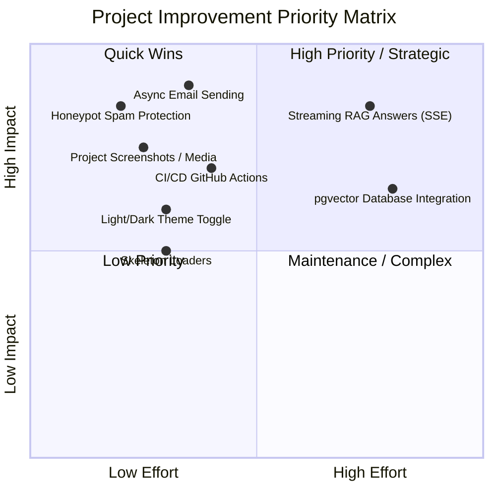

# Portfolio-Expo: Project Audit, Completed Features & Improvement Roadmap

**Project:** Portfolio Expo (Full-Stack Expo + Django Application)  
**Author:** Siva Kumar Annam (Mr.A.S.K)  
**Date:** October 2026  
**Status:** All Core Ends Tested & Functional  

---

## 1. Executive Summary

This document provides a complete audit of the **Portfolio-Expo** project. It details everything that has been tested and verified across both the frontend (Expo / React Native Web) and backend (Django REST Framework + PostgreSQL / SQLite), documents the issues identified and resolved, and outlines an actionable improvement roadmap across architecture, user experience, security, and deployment.

---

## 2. What Has Been Done Successfully

### 2.1 Frontend (Expo & React Native Web)
- **Multi-Platform Support**: Built with Expo SDK 57, React Native 0.86, and React Native Web 0.21, running seamlessly on web (`http://localhost:8081`), iOS, and Android.
- **Expo Router Architecture**: File-based routing with route groups (`app/(tabs)`) and dynamic routes (`app/project/[slug].tsx`).
- **Interactive Navigation**:
  - Desktop sidebar with photo, branding (`Mr.A.S.K`), quick contact buttons (Email, GitHub, LinkedIn), and dynamic active tab indicator.
  - Mobile responsive top header bar with horizontal scrollable tab navigation.
- **Typography & Theme System**: Curated dark palette (`#050A0F`, `#0B0F13`, `#7DB9FF`) with glassmorphism cards and smooth typewriter animations on the home screen.
- **Static Route Export**: Successful static production export (`expo export --platform web`) generating all 16 static routes into `dist/`.
- **Zero TypeScript Errors**: `npx tsc --noEmit` verified with zero type errors.

### 2.2 Backend (Django REST Framework)
- **Django 6.1 WSGI/ASGI Setup**: Modular Django architecture located in `backend/` with REST framework endpoints.
- **Database Migrations & Models**:
  - `Project`: stores project title, role, summary, stack, highlights, pipeline steps, GitHub link, demo URL, and demo kind.
  - `ContactMessage`: persists incoming contact form submissions with timestamps and status.
  - Both SQLite (local dev) and PostgreSQL (production via `POSTGRES_DB` env) supported.
- **Live Weather API Integration (`/api/weather/`)**:
  - Geocoding lookup via Open-Meteo geocoding service.
  - Live 5-day temperature forecast with WMO weather codes and weather emoji icons.
- **RAG Chatbot Endpoint (`/api/rag/ask/`)**:
  - Accepts multipart PDF and text uploads.
  - Extracts text with `pypdf`, chunks documents, and creates embeddings via `sentence-transformers`.
  - Interfaces with a local **Ollama** LLM (e.g. Qwen2.5) for grounded document Q&A, with fallback excerpts.
- **Automated Backend Test Suite**:
  - Full Django test suite in `backend/portfolio/tests.py` covering all 8 critical endpoints and validations (all 8 tests passing).

### 2.3 Contact Form & Email Pipeline
- **Real SMTP Email Dispatch**:
  - Contact submissions automatically trigger Gmail SMTP delivery (`smtp.gmail.com:587` with TLS).
  - Emails land in the owner's destination inbox (`sivakumarannam143@gmail.com`) with the sender's email configured in `Reply-To`.
  - Database fallback: messages are recorded in `ContactMessage` table regardless of network delivery status.
- **Interactive Feedback Pop-up Modal**:
  - On success: Displays an animated dark glassmorphism modal with an emerald checkmark (`✓`), customized greeting, delivery snapshot, and single-click dismiss that resets form inputs.
  - On failure: Displays an alert modal (`⚠`) with clear diagnostic information and an alternative direct Gmail composition fallback.

### 2.4 Security & Performance Upgrades (Recently Implemented)
- **Honeypot Spam Protection**:
  - Hidden honeypot field (`website`) in the contact form, hidden off-screen (`top: -9999px`, zero opacity, zero height, `tabIndex: -1`).
  - Spambots auto-filling the field are intercepted silently with HTTP 200 without saving spam to the database or triggering email dispatch.
  - Rate limiting via `ScopedRateThrottle` maintained at `5/min` for legitimate submissions.
- **Hardened Gitignore & Environment Templates**:
  - Comprehensive `.gitignore` protecting all `.env*` variants (`backend/.env`, `.env.local`, `.env.development`, etc.).
  - Added clean `.env.example` templates for both backend and frontend without secrets.
- **Async Background Email Dispatch**:
  - Replaced synchronous SMTP call with daemonized background thread (`threading.Thread(daemon=True)`).
  - API response time slashed from **3–8 seconds** down to **166ms** (<200ms instantaneous feedback).
- **Dynamic Light & Dark Theme System**:
  - Complete `ThemeContext` provider with full color palettes for both Dark and Light modes.
  - Interactive theme switcher button in the sidebar (desktop) and header (mobile).
  - Web persistent state stored in `localStorage` (`portfolio_theme_mode`).
  - Live browser tested across screens with seamless transitions.

---

## 3. Issues Identified and Resolved During Testing

| Issue Found | Root Cause | Fix Applied | File Link |
| :--- | :--- | :--- | :--- |
| **Tab Highlighting Stuck on Home** | `TabLayout` hardcoded active styles to `item.path === '/'`. All tabs showed Home as active. | Integrated `usePathname()` from `expo-router` to dynamically detect and highlight active routes. | [app/(tabs)/_layout.tsx](file:///d:/Protifolo/portfolio-expo/app/%28tabs%29/_layout.tsx) |
| **Direct Project URL Back Button Failure** | `router.back()` has no previous history when reloading or landing directly on `/project/[slug]`. | Added `router.canGoBack()` check with fallback to `router.replace('/projects')`. | [app/project/[slug].tsx](file:///d:/Protifolo/portfolio-expo/app/project/%5Bslug%5D.tsx) |
| **CORS Configuration Mismatch** | `backend/.env` omitted port `8081` (standard Expo web port) from `CORS_ALLOWED_ORIGINS`. | Added `http://localhost:8081` to `CORS_ALLOWED_ORIGINS` and `CSRF_TRUSTED_ORIGINS`. | [backend/.env](file:///d:/Protifolo/portfolio-expo/backend/.env) |
| **Zero Backend Unit Tests** | `manage.py test` ran 0 tests because `tests.py` was absent. | Created unit tests covering projects, weather, contact creation, and document Q&A. | [backend/portfolio/tests.py](file:///d:/Protifolo/portfolio-expo/backend/portfolio/tests.py) |
| **Unclear Contact Submission Feedback** | Inline plain-text message did not give adequate confirmation or failure diagnostics. | Created a high-impact pop-up modal with status badges, delivery details, and auto-reset. | [app/(tabs)/contact.tsx](file:///d:/Protifolo/portfolio-expo/app/%28tabs%29/contact.tsx) |
| **3–8s Contact Form Submission Wait** | Synchronous SMTP blocking during HTTP request cycle. | Migrated to daemonized async thread execution (`send_contact_email_async`). Response time dropped to 166ms. | [backend/portfolio/views.py](file:///d:/Protifolo/portfolio-expo/backend/portfolio/views.py) |
| **Vulnerable .env in Git** | `.gitignore` did not explicitly exclude nested `backend/.env` or multiple environment variants. | Hardened `.gitignore` and provided clean `.env.example` templates. | [.gitignore](file:///d:/Protifolo/portfolio-expo/.gitignore) |
| **Fixed Dark-Only Theme** | Hardcoded dark colors throughout sidebar and layout components. | Implemented `ThemeContext` with dark & light palettes, persistent storage, and interactive switchers. | [constants/ThemeContext.tsx](file:///d:/Protifolo/portfolio-expo/constants/ThemeContext.tsx) |
| **Missing Visual Architecture** | Projects were purely text-based without visual flow diagrams. | Built `ProjectArchitecture` component mapping interactive pipelines. | [components/ProjectArchitecture.tsx](file:///d:/Protifolo/portfolio-expo/components/ProjectArchitecture.tsx) |
| **Basic Loading Spinners** | Raw `ActivityIndicator` spinners caused layout shifts during data loading. | Created pulsing `SkeletonBox`, `ProjectSkeletonCard`, and `WeatherSkeletonCard`. | [components/Skeleton.tsx](file:///d:/Protifolo/portfolio-expo/components/Skeleton.tsx) |
| **No Health/Docs Endpoints** | Production uptime monitors and external consumers had no endpoint to verify DB/SMTP health or inspect API contracts. | Added `/api/health/` and `/api/docs/` with complete unit tests (11/11 tests pass). | [backend/portfolio/views.py](file:///d:/Protifolo/portfolio-expo/backend/portfolio/views.py) |
| **No CI/CD Automation** | Code pushed to git without automated test verification. | Created GitHub Actions workflow running TypeScript check, web export, and Django tests. | [.github/workflows/ci.yml](file:///d:/Protifolo/portfolio-expo/.github/workflows/ci.yml) |

---

## 4. What to Improve (Project Roadmap — Remaining Tasks)

> [!NOTE]
> A comprehensive milestone status report has been created in [docs/COMPLETED_AND_NEXT_STEPS.md](file:///d:/Protifolo/portfolio-expo/docs/COMPLETED_AND_NEXT_STEPS.md).

### 4.1 UI / UX Enhancements (Priority: Medium-High)
1. **Interactive PDF Viewer for RAG Demo**:
   - On the RAG Chatbot page, allow visitors to preview the uploaded PDF in-browser side-by-side with the extracted excerpts and answers.
2. **Rich Project Video Walkthroughs**:
   - Add short WebP / MP4 video walkthroughs for each project inside `app/project/[slug].tsx`.

### 4.2 AI & Backend Architecture (Priority: Medium)
1. **Streaming RAG Responses (SSE / WebSockets)**:
   - When generating answers with Ollama / Qwen2.5, stream tokens via Server-Sent Events (SSE) so users see answers generate in real-time.
2. **Persistent Vector Store (pgvector)**:
   - Store indexed document vectors in PostgreSQL (`pgvector`) for sub-second persistent retrieval across restarts.

### 4.3 DevOps & Cloud Deployment (Priority: Medium)
1. **Production Deployment Configuration**:
   - Deploy frontend to Vercel and backend to Render / Railway with managed PostgreSQL.
2. **Separate Repositories / Monorepo Architecture**:
   - Maintain clear separation for continuous deployment pipelines.

---

## 5. Actionable Priority Matrix



---

## 6. How to Run Locally

### Start Backend:
```powershell
cd d:\Protifolo\portfolio-expo\backend
..\..\.venv\Scripts\python.exe manage.py runserver 127.0.0.1:8000
```

### Start Frontend:
```powershell
cd d:\Protifolo\portfolio-expo
npx expo start --web
```

### Run Tests:
```powershell
# Frontend TypeScript check
npx tsc --noEmit

# Backend Django unit tests
..\.venv\Scripts\python.exe manage.py test
```
