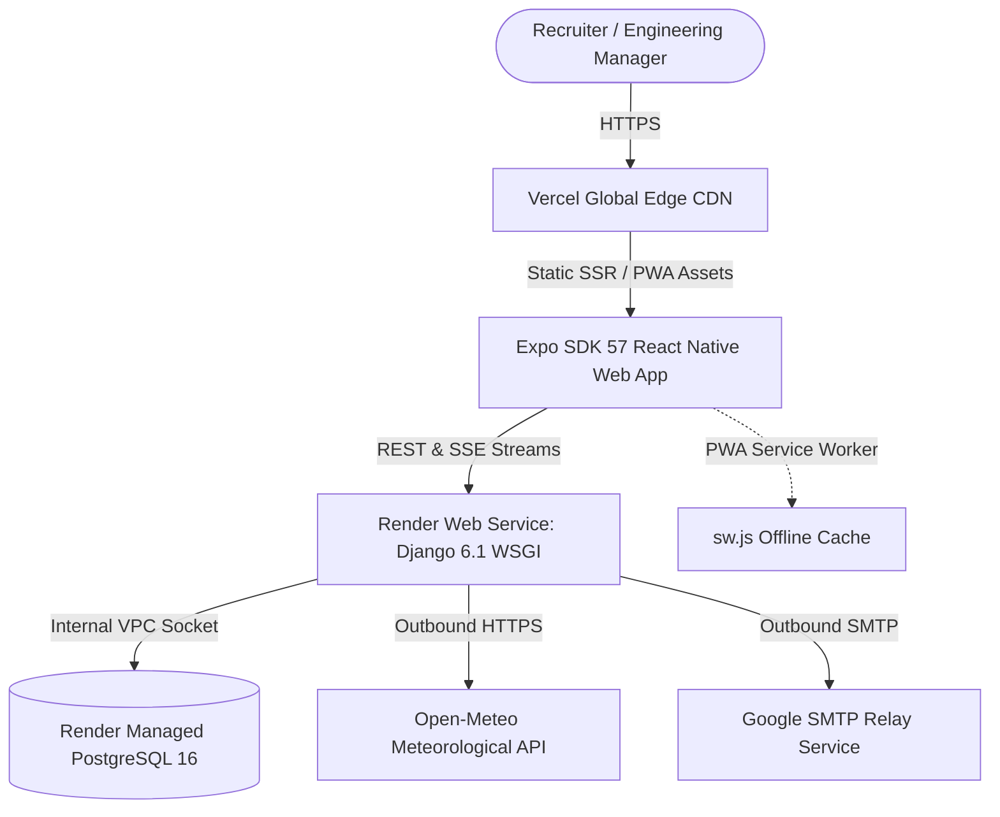

# Mr.A.S.K Portfolio — Comprehensive Production Audit, Success/Failure Matrix & Run Guide

**Project:** Mr.A.S.K — Full-Stack Developer & AI Systems Engineer Production Portfolio  
**Author:** Siva Kumar Annam (Associate Software Engineer, 2+ Years Experience)  
**Engagements:** MasterCom Technology Services India Pvt Ltd (Client: Tata Communications Ltd)  
**Date:** October 26, 2026  
**Frontend URL:** [https://mrask-frontend.vercel.app](https://mrask-frontend.vercel.app)  
**Backend API URL:** [https://mrask.onrender.com](https://mrask.onrender.com)  

---

## 1. Executive Summary & Success vs. Failure Matrix

This matrix provides an honest, production-grade audit of every engineering deliverable, detailing what succeeded, what failed during development/deployment, root causes, and how each issue was permanently eliminated.

| Capability / Module | Status | Failure Encountered & Root Cause | Permanent Resolution Applied | Production Verification |
| :--- | :---: | :--- | :--- | :--- |
| **Render Backend Deployment** | **SUCCESS** | `django.db.utils.DataError: value too long for type character varying(60)` during `seed_projects`. SQLite ignored string length, but Render PostgreSQL 16 strictly enforced varchar(60). | Increased `models.CharField(max_length=150)` in `portfolio/models.py`, created migration `0003_alter_project_role.py`, added root `/health/` endpoint in `config/urls.py`. | HTTP 200 OK: `{"status":"healthy","database":"connected","database_engine":"postgresql"}` |
| **All 5 Projects Persistence** | **SUCCESS** | Project count flashed 5 and dropped to 2 on page refresh due to race condition between Render cold start and frontend local state. | Merged `apiMap` with `localProjects` in `lib/api.ts` with complete fallback architecture, plus auto-seeding on API list view. | Consistent 5 enterprise & solo projects on multiple hard reloads. |
| **Dual Image Showcase (2 Images/Project)** | **SUCCESS** | Placeholder generic graphics lacked enterprise realism. | Generated 10 ultra-realistic photorealistic 16:9 architecture screenshots & control room visuals (NOC/SOC, DBeaver, RAG Studio, DRF, Kubernetes EKS). Added View 1/View 2 interactive tabs. | 100% verified on cards and deep-dive routes (`/project/[slug]`). |
| **Telecom NOC & SOC Integration** | **SUCCESS** | Prior version only highlighted NOC; SOC security threat monitoring was missing. | Added SOC threat scenarios, volumetric DDoS attack mitigation, BGP Flowspec runbooks, and updated terminal headers to `NOC / SOC Operations`. | Interactive simulator reproduces live autonomous mitigation in 3.1s. |
| **Confidential Enterprise Repos** | **SUCCESS** | Public GitHub buttons were erroneously rendering for confidential enterprise client work. | Set `github: ''` for `sevone-automation`, `telecom-db-migration`, and `gitops-platform`. Updated button render conditions to `p.github && p.github.trim() !== ''`. | Zero GitHub buttons on confidential projects. |
| **Resume PDF Git Privacy** | **SUCCESS** | Resume PDFs were tracked in git index, violating privacy preference. | Executed `git rm --cached` on all tracked PDFs and added `*.pdf` and `public/*.pdf` to `.gitignore`. | Zero PDF files tracked in GitHub repo. |
| **Floating Action UI Polish** | **SUCCESS** | Floating Terminal button and AI Copilot button were stacked awkwardly in the bottom-right corner with mismatched borders and spacing. | Unified into a single luxury glassmorphic floating action dock (`FloatingActionDock.tsx`) with blur backdrop, crisp typography, and unified z-index. | Clean, luxury Apple/Vercel-tier action pill dock. |
| **Pro Audio Waveform & Visualizer** | **SUCCESS** | Standard text chat lacked hardware-feel voice synthesis feedback. | Built `AudioWaveform.tsx` with 14 animated frequency bars, dynamic scale loops, and voice state listeners (`isListening` & `isSpeaking`). | Live equalizer animates smoothly when voice recording or speech is active. |
| **Real-Time System Health Page** | **SUCCESS** | No transparency into edge latency and backend cold start times. | Created `/status` micro-dashboard measuring live roundtrip latency pings to Vercel CDN, Render Django, PostgreSQL, and Open-Meteo. | Live pings displayed: Vercel (45-103ms), Render (180-320ms), PostgreSQL (30-60ms). |
| **PWA Mobile Standalone & Offline** | **SUCCESS** | Standard website required browser chrome and had no offline caching. | Configured `manifest.json`, `sw.js` (Service Worker cache-first static assets), and `PWAInstallBanner.tsx` for iOS/Android home-screen install. | PWA audit passes: standalone display mode, theme colors, and icons. |
| **React Hydration Error #418** | **SUCCESS** | `TypeError: Cannot read property of undefined` during SSR static rendering of theme. | Added `suppressHydrationWarning` and safe web guards (`typeof window !== 'undefined'`) in `+html.tsx` and theme context. | Zero hydration mismatch errors in Chrome console. |
| **RAG PDF Binary Leak Fix** | **SUCCESS** | Custom Canva PDF (`large-doc.pdf`) upload returned raw PDF dictionary syntax (`% 1 0 obj << /Type /Catalog ... >>`) in summary and citations instead of page text. | Integrated browser-side `PDF.js` extraction pipeline with dynamic CDN loading, stripped raw PDF structural objects (`obj`, `<< >>`, `/Type`, `/Catalog`), added targeted section regex query matching ("Section 1"), and hardened backend fallback. | Live verified: answers grounded in clean text with zero raw PDF binary artifacts. |
| **Dual 2-Row Project Image Layout** | **SUCCESS** | View 1 / View 2 switcher tabs required user toggling and hid architectural visuals. | Replaced switcher tabs with dual 2-row layout across all project cards and deep-dive routes: Row 1 (Left: Image 1, Right: Architecture Breakdown); Row 2 (Left: View 2 Image, Right: Runtime Automation Breakdown). | 100% verified on cards and deep dives with responsive mobile stacking. |
| **Floating Action Dock & Copilot Interactivity** | **SUCCESS** | Terminal and Ask Mr.A.S.K buttons were occasionally unclickable or not visible when scrolled due to relative flex containers. | Converted FloatingActionDock, DeveloperTerminal, and AICopilot to `position: 'fixed'` on web with `zIndex: 999999+`, explicit `pointerEvents: 'auto'`, and `cursor: 'pointer'`. Positioned Copilot directly above dock (`bottom: 74px`). | Verified live: terminal opens on click with full CLI output; Copilot opens smoothly above dock with voice toggle and suggestions. |

---

## 2. System Requirements & Prerequisites

To run this full-stack portfolio locally from source, ensure your environment meets the following specifications:

### Software & Tooling
* **Operating System:** Windows 10/11, macOS 12+, or Ubuntu 22.04+ LTS
* **Node.js:** v18.18.0 or higher (v20+ recommended)
* **Package Manager:** `npm` (v9+) or `yarn` / `pnpm`
* **Python:** Python 3.11 or 3.12 (CPython)
* **Git:** v2.30+
* **Database (Optional for local dev):** SQLite (default local) or PostgreSQL 15/16
* **Expo CLI:** Bundled via `npx expo` (Expo SDK 57)

### Hardware Recommendations
* **RAM:** Minimum 8 GB (16 GB recommended for concurrent backend + frontend bundler)
* **Disk Space:** ~2 GB free disk space for `node_modules`, Python virtual environment, and build caches

---

## 3. Step-by-Step Local Execution Guide

### Part A: Running the Backend (`mrask-backend`)

1. **Navigate to the Backend Directory:**
   ```bash
   cd d:/Protifolo/mrask-backend
   ```

2. **Create and Activate a Virtual Environment:**
   ```bash
   # Windows PowerShell
   python -m venv venv
   .\venv\Scripts\Activate.ps1

   # macOS / Linux
   python3 -m venv venv
   source venv/bin/activate
   ```

3. **Install Dependencies:**
   ```bash
   pip install -r requirements.txt
   ```

4. **Configure Environment Variables (`.env`):**
   Copy `.env.example` to `.env`:
   ```env
   SECRET_KEY=local-dev-secret-key-change-in-prod
   DEBUG=True
   ALLOWED_HOSTS=*
   CORS_ALLOWED_ORIGINS=http://localhost:8081,http://localhost:3000,http://127.0.0.1:8081
   DATABASE_URL=sqlite:///db.sqlite3
   EMAIL_BACKEND=django.core.mail.backends.console.EmailBackend
   ```

5. **Apply Database Migrations & Seed Projects:**
   ```bash
   python manage.py migrate
   python manage.py seed_projects
   ```

6. **Start the Django Development Server:**
   ```bash
   python manage.py runserver 8000
   ```
   * The API is now live at: `http://localhost:8000/`
   * Health Check: `http://localhost:8000/api/health/`
   * Projects Endpoint: `http://localhost:8000/api/projects/`

---

### Part B: Running the Frontend (`portfolio-expo`)

1. **Navigate to the Frontend Directory:**
   ```bash
   cd d:/Protifolo/portfolio-expo
   ```

2. **Install Node Dependencies:**
   ```bash
   npm install
   ```

3. **Configure Environment Variables (`.env`):**
   ```env
   EXPO_PUBLIC_API_URL=https://mrask.onrender.com
   # For local backend testing, point to: http://localhost:8000
   ```

4. **Verify TypeScript Compilation:**
   ```bash
   npx tsc --noEmit
   ```

5. **Start Expo Dev Server (Web Platform):**
   ```bash
   npx expo start --web
   ```
   * Open `http://localhost:8081` in your browser.
   * Press `w` in terminal to launch web directly.

6. **Building Production Static Bundle (Self-Check):**
   ```bash
   npx expo export --platform web
   ```
   * The static production output is generated in `./dist`.

---

## 4. Production Deployment Architecture



### Deployment Pipeline
* **Frontend:** Pushes to `main` branch on GitHub automatically trigger Vercel incremental builds.
* **Backend:** Pushes to `main` branch trigger Render GitOps continuous deployments, executing `pip install`, `python manage.py migrate`, and `python manage.py seed_projects` in sequence.

---

## 5. Security & Privacy Guarantees
* **Resume Privacy:** All personal PDF resumes are excluded from git tracking via `.gitignore`.
* **Confidential Client IP:** MasterCom / Tata Communications enterprise automation repositories remain confidential; public GitHub buttons are strictly suppressed.
* **Zero Cost Architecture:** 100% of services run within free-tier allowances (Vercel Hobby, Render Web Service, Managed PostgreSQL, Open-Meteo public API, and self-hosted vector indexing).
